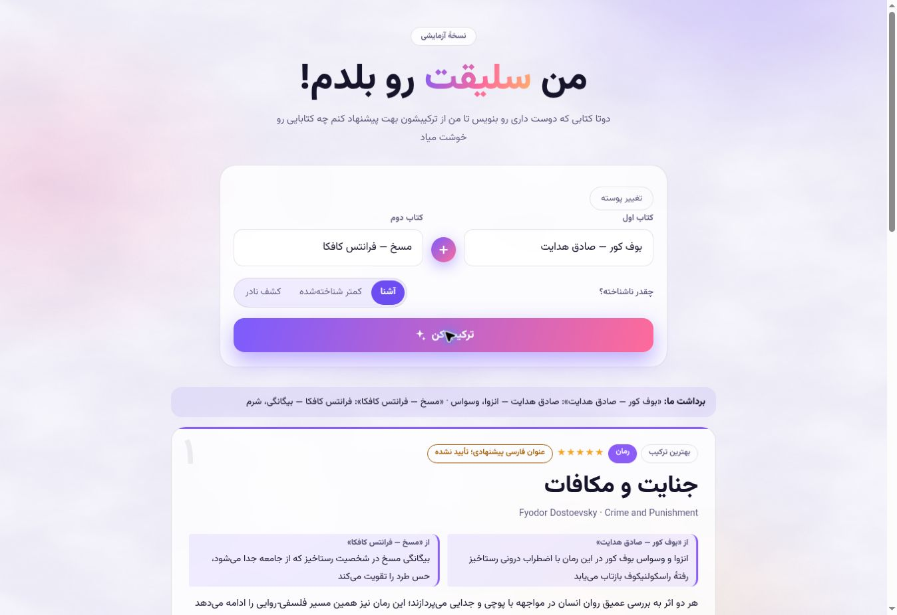

# Acceptance results — 2026-10-21

Tested application commit: d9dca05cd0ae9c7c119bcb08759441cc10b373cb.
Cloudflare Pages reported a successful deployment. Production: https://booktaste.pages.dev/.

## Passed

- 38 Node regression tests (26 API, 12 UI), zero failures.
- Chromium layout checks: 320, 360, 390, 768 and 1366px, both themes (10 combinations). Long cards did not create horizontal overflow. These layout tests ran during this repair cycle before the final model/parser/catalog-only updates and a source-link color correction.
- Live browser submission: Blind Owl / Metamorphosis with author names, familiar setting: six cards with original-title/author catalog links; controls released after completion.
- Live API: known pair with authors returned six catalog-matched books in 61.71s on the preceding GPT model deployment.
- Final deployment: Little Prince / Man's Search for Meaning, less-known setting, returned one verified recommendation (Siddhartha) in 105.77s. The same request returned HTTP 200 in 4.32s on repetition, with caching enabled.
- Earlier live checks in this repair cycle: malformed JSON and normalized duplicate inputs returned 400; an invented input returned known=false with no fabricated suggestions; theme persistence, read-list removal and clearing worked.

## Remaining limitations

- AI-generated Persian titles and thematic explanations are NOT independently verified. A real catalog record does not establish translation or interpretation accuracy. Live responses still contained awkward/incorrect Persian phrasing and title translations; the UI explicitly marks these as unverified and links the original record.
- Fresh generation can take roughly a minute or approach the request deadline. Verified partial results are displayed honestly when six matches cannot be found. Cache timing is an observation, not a latency guarantee.
- Catalog coverage, availability, model availability and free-tier quotas remain external dependencies. Exhaustion and outages show recoverable errors; no paid service was enabled.
- Automated AI/catalog responses are mocked. No claim is made about every future model response. No load/stress test, independent penetration test, Safari/iOS test or real-device test was performed.

